# RIOSE

  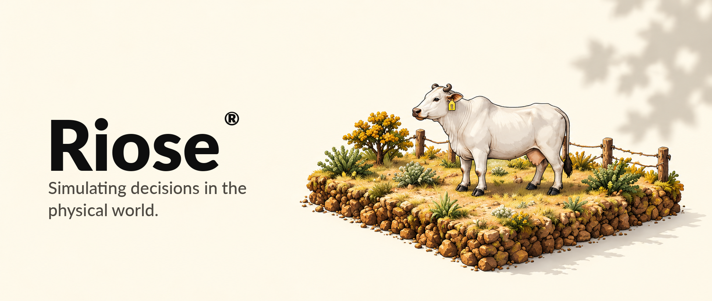

**An exploratory livestock simulation and experiment workspace, with a separately scoped AMD ROCm validation record.**

RIOSE compares livestock scenarios in a browser. Results are deterministic demonstrations from simplified rules, not validated forecasts or management recommendations.

[Live demo](https://agro-smallville-mvp.qwdqwdwqdqdqwdwwqqw.chatgpt.site) · [Experiment workspace](experiments.html) · [AMD evidence](docs/evidence/amd/AMD_VALIDATION.md) · [Scientific model notes](docs/modelos/interface-modelos-cientificos.md) · [Repository guide](docs/architecture/repository-layout.md)

`amd` · `rocm` · `pytorch` · `simulation` · `livestock`

## Product workspace

Set a baseline, change one selected factor, and compare the two simulated runs.

<table>
  <thead>
    <tr><th>Experiment workspace</th><th>Scenario comparison</th></tr>
  </thead>
  <tbody>
    <tr>
      <td>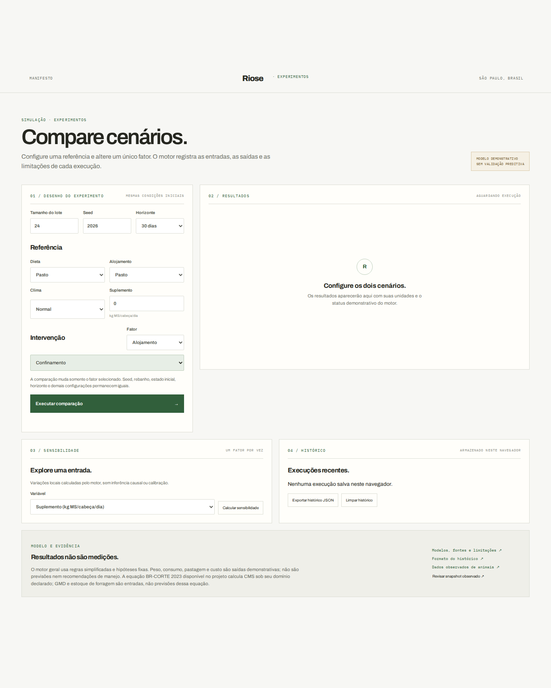</td>
      <td>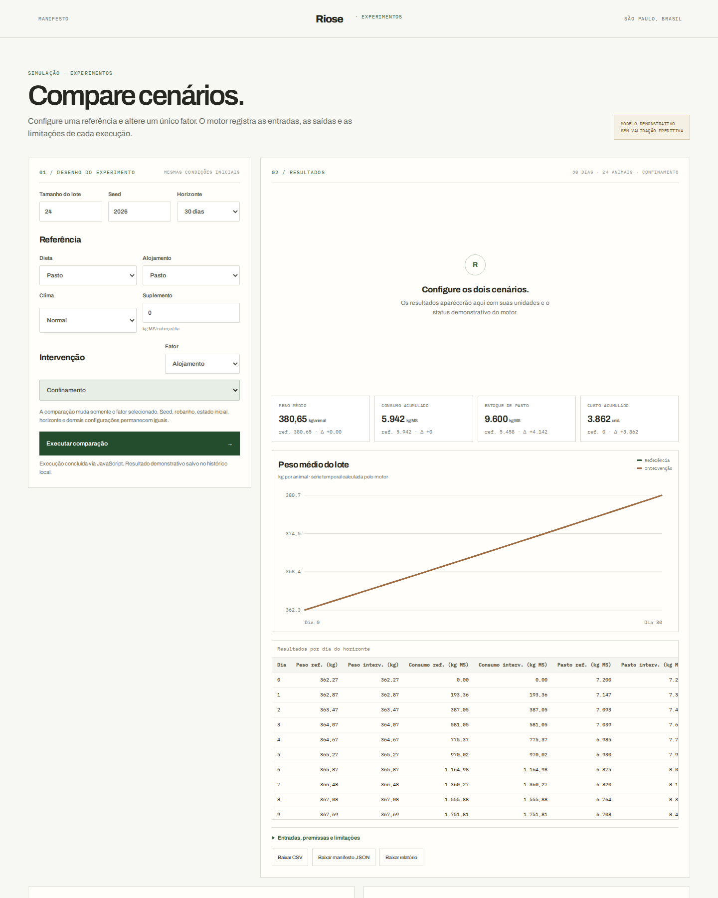</td>
    </tr>
  </tbody>
</table>

## How it works

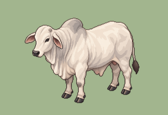

RIOSE is an exploratory prototype with a deterministic JavaScript engine, a browser workspace, reproducible experiment records, optional Rust/WebAssembly components, and separate pages for public observed data.

 

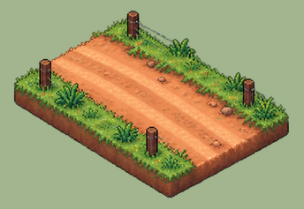

Each comparison uses the same seed and starting conditions, then changes one selected factor. Inputs, outputs, charts, daily results, and limitations are shown together. Results can be saved in local browser history or exported.

 

## Product walkthrough

The illustrations are concept art only; the current workspace does not render them.

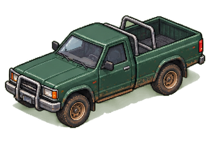

Open [experiments.html](experiments.html) to configure and run a comparison. The workspace also includes one-factor sensitivity exploration and local run history.

 

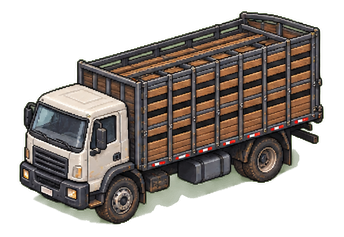

[Observed-data pages](adult-data.html) explore published measurements separately; those records do not calibrate or initialize the simulation.

 

## Visual concept

The interface uses an editorial, chart-focused style. The [isometric asset sheet](docs/assets/readme/03-visual-concept-asset-sheet.png) and the illustrations below are concept art only. The current workspace does not render these farm scenes or assets.

  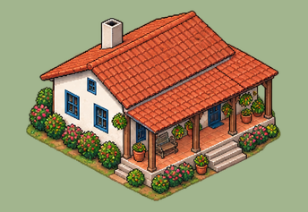
  &nbsp;&nbsp;
  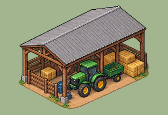
   
  Farmhouse and tractor concepts, centered as a pair.

## AMD + ROCm evidence

A successful parity run was recorded on a separate release revision, commit [acb5cdf6e3bc23d7e48026bc736da05427f89907](https://github.com/GUZZBR1/riose-agro/commit/acb5cdf6e3bc23d7e48026bc736da05427f89907).

| Workload | Device and runtime | Result |
| --- | --- | --- |
| riose-livestock-metabolism-batch | AMD Instinct MI300X VF · ROCm/HIP 7.14.60850 · PyTorch 2.11.0+rocm7.14.1 | amd_rocm backend; 24 animals; 48 outputs; parity PASS; max absolute difference 0 at 1e-12 tolerances |

This verifies only that workload and environment. It does not establish performance gains, biological validity, or support for the full simulator on current main.

<table>
  <thead>
    <tr><th>01 · AMD environment</th><th>02 · Product validation</th></tr>
  </thead>
  <tbody>
    <tr>
      <td>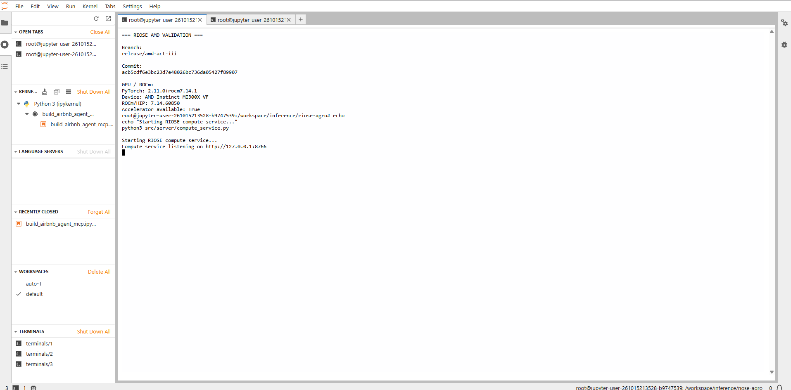</td>
      <td>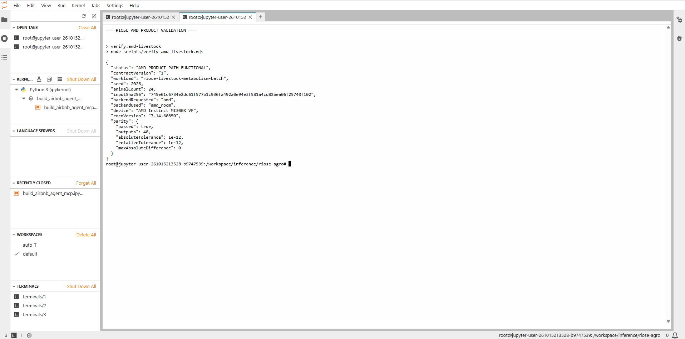</td>
    </tr>
    <tr>
      <td colspan="2" align="center"><strong>03 · Backend detection</strong> 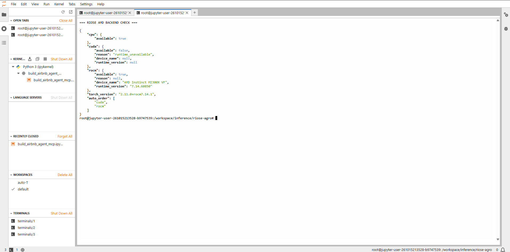</td>
    </tr>
  </tbody>
</table>

See [AMD_VALIDATION.md](docs/evidence/amd/AMD_VALIDATION.md) for run details and reproduction notes.

## Scientific scope and limitations

- The engine uses simplified rules and fixed assumptions; no dataset calibrates the complete simulator.
- Observed measurements and simulated outputs are kept separate. Public-data checks are component diagnostics, not whole-model validation or causal evidence.
- BR-CORTE 2023 calculates dry-matter intake only within its declared domain; weight gain and forage stock are inputs, not predictions from that equation.
- Outputs are illustrative and must not guide real animal-management decisions. Dataset scope and audits are in [docs/evidence](docs/evidence/) and [scientific model notes](docs/modelos/interface-modelos-cientificos.md).

Evidence labels distinguish **SIMULATED**, **OBSERVED**, **ASSUMED**, **EXPERIMENTAL**, **VALIDATED** (only for a documented path and criterion), and **FUTURE** work.

## Repository and local setup

The browser app is in <code>experiments.html</code> and <code>src/client/</code>; the local server and optional compute endpoint are in <code>src/server/</code>. Rust and opt-in WebAssembly components are in <code>crates/riose-core/</code> and <code>wasm/</code>. On current main, the compute endpoint supports numeric vector scaling, not the full farm simulation. See the [repository layout](docs/architecture/repository-layout.md) and [CI guide](docs/ci.md).

Requires Node.js 20 or newer:

~~~bash
npm install
npm start
~~~

Open the local URL and select <code>experiments.html</code>. The server binds to loopback by default; remote access requires <code>ALLOW_REMOTE_ACCESS=true</code> and is unauthenticated. Snapshot review checks a linked file without changing simulation data. The optional WASM metabolism kernel uses <code>experiments.html?engine=wasm</code> and <code>npm run build:wasm</code> (requires Rust's <code>wasm32-unknown-unknown</code> target).

Project pages: [home](home.html) · [manifesto](manifesto.html) · [observed data](adult-data.html) · [adult cow data](adult-cow-data.html).

## License and data

Project code is under the [MIT License](LICENSE). Third-party datasets have separate terms; review their manifests and [THIRD-PARTY-NOTICES.md](THIRD-PARTY-NOTICES.md) before reuse or redistribution.

## RIOSE

  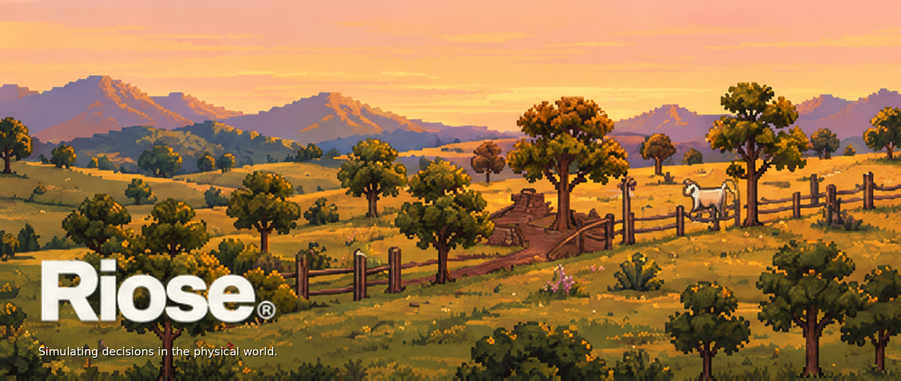

